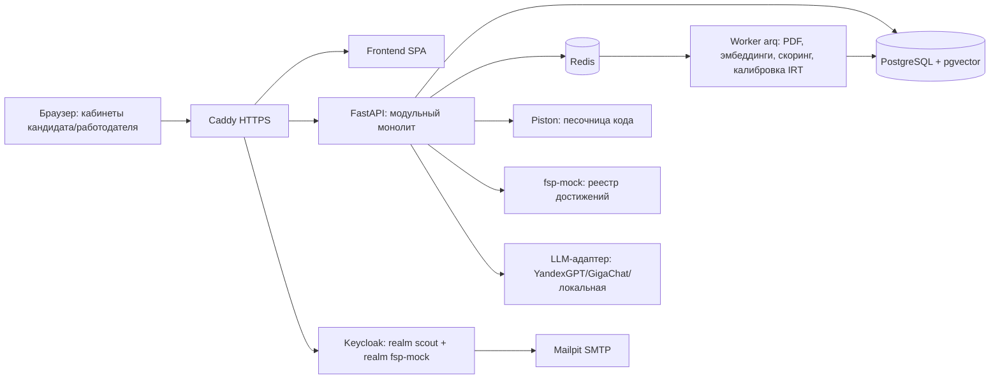

# «Скаут» — платформа обратного найма ИТ-специалистов с верифицированным профилем ФСП

Рабочее название: «Скаут» (работодатель как скаут, сам ищет таланты). Спецтрек ФСП, ЛЦТ 2026, задача № 8.1.

---

## 0. Рамки конкурса (регламент + ТЗ)

| Что | Значение |
|---|---|
| Дисциплина | «Спортивное программирование», дисциплина «продуктовое программирование» (всероссийское физкультурное мероприятие) |
| Сроки | ТЗ: 05.10 · **разработка 05–11.10** · экспертиза 12–18.10 · финалисты 19.10 · финальный этап 20–29.10 · **питч онлайн 24.10** · итоги 30.10 |
| Команда | 2–5 чел., граждане РФ, 16+, состав после подачи заявки не меняется |
| Куда сдавать | ЛК i.moscow → раздел «Хакатон»: прототип, презентация, доп. материалы (видео, скриншоты) |
| Финал | до 10 команд по задаче; 1 победитель + 2 призёра |
| Призы | 1 000 000 / 600 000 / 400 000 ₽, кубки, медали, дипломы Минспорта; спортивный разряд |
| Оригинальность | нельзя сдавать решение, уже внедрённое до начала приёма заявок; чужой код только с правами (open-source лицензии допустимы). Запрета на ИИ нет |
| Промежуточная сдача (ТЗ 5.1) | репозиторий + описание механик подбора и тестирования + демо базового сценария. **Дата в регламенте не указана, уточнить в чате/ЛК** |
| Финальная сдача (ТЗ 5.2) | репо (обяз.), презентация pptx/pdf (обяз.), стенд (крайне желательно, иначе видео + инструкция запуска), документация doc/pdf (обяз.) |
| Важно | стенд должен работать **до 30.10** (экспертиза и финал). Время дедлайна 11.10 уточнить, свой внутренний дедлайн 11.10 18:00 |

### Критерии → чем закрываем

| Критерий | Вес | Что показываем |
|---|---|---|
| Новая механика подбора | **35%** | Инвайт с открытой вилкой, анонимная карточка, квоты, отказ с причиной, «салари-радар», объяснимый скоринг, режим проверки на парах «вакансия–кандидат» |
| Тестирование, валидация, категоризация | **25%** | Параметризованные семейства задач + IRT + адаптивный тест (CAT), симуляция утечек, test-retest, дискриминативность, пилот с экспертной разметкой |
| UI/UX | 10% | Два кабинета, сквозной путь без пояснений, гамма ФСП, SUS-опрос |
| Питч | 10% | только в финале |
| Техническая проработка | 7% | Модульный монолит, OpenAPI, Docker Compose, Keycloak, тесты, CI |
| Доп. функционал | 7% | Вакансии и отклики, регулярные задания, антифрод и ATS (концепция), адаптив |
| Полнота и документация | 6% | Все обязательные шаги, корректная работа без истории ФСП, docs в PDF |

---

## 1. Суть решения

1. Кандидат не пишет резюме «для продажи». Он проходит обязательный путь: опрос → заявленный грейд → адаптивный тест. Система сама кладёт его в **категорию** «специализация × грейд».
2. Работодатель описывает потребность обычным текстом. Система разбирает её, предлагает категории и ранжированную подборку с объяснением, почему каждый кандидат в ней оказался.
3. Инициатива у работодателя: он отправляет **инвайт с обязательной вилкой**. Кандидат видит условия до общения, принимает или отклоняет с причиной. Контакты раскрываются только после принятия.
4. Достижения ФСП дают проверяемый бонус к рангу. Если истории ФСП нет, кандидат ничего не теряет.

---

## 2. Справочники (MVP)

- **Специализации (7):** Backend, Frontend, Mobile, QA, DevOps/SRE, Data/ML, Аналитик (системный/бизнес). Банки заданий делаем глубокими для Backend (Python/Go/Java) и Frontend, для остальных демо-банки.
- **Грейды (4):** Junior (до 1 года), Middle (1–3), Senior (3–6), Lead (6+, тест + кейс).
- **Отрасли:** финтех, e-com, госсектор, телеком, геймдев, edtech, медтех, промышленность и другие.
- **Навыки:** дерево специализация → компетенция → навык, плюс словарь синонимов («k8s» = «Kubernetes», «постгрес» = «PostgreSQL»). ~300 навыков, JSON в `seed/taxonomy/`.
- **Формат и условия:** офис, гибрид, удалёнка; город; занятость; вилка в ₽ от–до.

---

## 3. Путь кандидата

1. Регистрация по email с подтверждением (Keycloak + SMTP, в демо Mailpit), три отдельных согласия (обработка ПДн, показ профиля работодателям, получение данных ФСП).
2. Профиль: форма **или** загрузка PDF → автораспознавание (ФИО, контакты, стек, роли, стаж, софт-скиллы) → кандидат проверяет поля → профиль сохраняется.
3. **Опрос:** отрасль, специализация, основной стек, стаж, формат, ожидания по зарплате.
4. **Выбор грейда** → **тест на заявленный грейд** (раздел 4).
5. Результат: категория (например, «Backend · Middle»), перцентиль внутри категории, подтверждённые навыки с уровнем. Профиль попадает в выдачу работодателям.
6. Привязка ФСП ID (по желанию, можно позже).
7. Дальше: входящие инвайты, вакансии и отклики, регулярные задания, пересдача грейда (с ограничениями).
8. Автогенерация стандартизированного **PDF-профиля** (WeasyPrint) с QR-кодом на страницу проверки подлинности: грейд, дата подтверждения, достижения ФСП.

Без пройденного теста кандидат не виден в поиске по категориям (статус «грейд не подтверждён»).

---

## 4. Механика тестирования (25%)

### 4.1 Идея: «уникальный экземпляр, общая шкала»
Единый тест быстро утекает, а LLM-генерация под каждого кандидата не гарантирует одинаковую сложность. Наше решение собрано из трёх слоёв:

1. **Семейства задач (item families).** Задача хранится как шаблон с параметрами. Экземпляры одного семейства решаются одинаковыми шагами и различаются поверхностью: значениями, именами, схемой БД, порядком опций, формулировкой. Правильный ответ вычисляется из параметров, поэтому выученный ответ одного экземпляра не подходит к другому.
2. **Калибровка IRT (2PL).** У каждого семейства есть сложность `b` и дискриминативность `a`. Экземпляры изоморфны, поэтому делят параметры семейства. Оценка кандидата θ лежит на одной шкале при любых доставшихся заданиях, так что результаты сопоставимы между кандидатами.
3. **Адаптивный отбор (CAT).** Следующее задание выбирается по максимуму информации Фишера в текущей θ: случайно из топ-5 (randomesque), с ограничением экспозиции (одно семейство попадается не больше чем в 20% сессий) и с покрытием компетенций по бланку теста.

LLM работает **офлайн, до теста**: генерирует изоморфные варианты и перефразировки. Дальше автоматический контроль: эталонное решение прогоняется в песочнице, проверяется однозначность ответа, ансамбль LLM-решателей даёт прокси-оценку сложности. После этого варианты калибруются на пилоте. Онлайн LLM только предварительно оценивает открытые ответы по рубрике, а последнее слово остаётся за правилами или человеком.

### 4.2 Состав теста (~40 мин)
| Блок | Формат | Вклад |
|---|---|---|
| A. Адаптивный | 10–18 заданий: чтение кода («что выведет»), найди баг, SQL на сгенерированной схеме, выбор архитектурного решения, короткий числовой ответ | θ (основа грейда) |
| B. Практика | 1 параметризованная задача с автотестами в песочнице (Piston, Python/JS/Go); для QA, аналитиков и DevOps кейс (тест-план, разбор лога, конфиг) | θ + подтверждённые навыки |
| C. Подход (опц.) | «Предложи решение» до 1500 символов, оценка по рубрике (LLM + выборочно эксперт) + уточняющий вопрос по коду из блока B | профиль, флаг уверенности |

Остановка CAT: SE(θ) < 0.35 или 18 заданий (минимум 10). Оценка θ методом EAP.

### 4.3 Вакансия → тест
Из описания вакансии извлекаются навыки и веса, по ним строится **бланк теста** (доли компетенций, например Go 40%, SQL 25%, Kafka 15%, system design 20%). CAT выбирает семейства в пределах бланка. В UI это отдельный экран «Как система построила тест под вакансию». Готовим 5 демо-вакансий.

### 4.4 Решение по грейду
- Сдал: `P(θ ≥ cut_грейда) ≥ 0.7`. Пороги `cut` задаём экспертно: эксперт отмечает якорные задания, которые должен решать грейд (упрощённый Ангоф), и уточняем на пилоте.
- Сдал уверенно: `P(θ ≥ cut_следующего) ≥ 0.7`, система предлагает тест на грейд выше.
- Не сдал: грейд **не понижается принудительно**, кандидату сразу предлагается тест на грейд ниже (одна попытка).
- Ограничения: подтверждённый грейд меняется не чаще **1 раза в 90 дней**; повторная попытка на тот же грейд через 30 дней. Вся история опросов и тестов хранится и видна кандидату.

### 4.5 Защита от утечек и списывания
- Комбинаторное пространство: семейства × параметры дают тысячи экземпляров, ответ не переносится.
- Мониторинг дрейфа: если доля верных ответов по семейству растёт у кандидатов с той же θ (DIF по времени), семейство помечается как скомпрометированное и выводится из ротации.
- Модель времени ответа (лог-нормальная, ван дер Линден): аномально быстрые верные ответы на сложных заданиях снижают уверенность. Плюс потеря фокуса и вставка из буфера. Это флаги, не автоматический провал.
- Уточняющий вопрос по собственному коду (блок C) отсекает решения, написанные не кандидатом.
- Регулярные задания и обратная связь работодателя («грейд на интервью подтвердился: да/нет») служат постоянной перепроверкой.

### 4.6 Регулярные задания (доп. функционал)
Работодатель публикует короткую задачу (до 30 минут: мини-код, ревью фрагмента, «предложи подход»). Система раздаёт её кандидатам подходящих категорий, не чаще одной задачи в 2 недели на человека. Решение оценивается по рубрике работодателя с предварительной LLM-оценкой. Хорошее решение даёт бейдж «свежий сигнал», поднимает `freshness` и позволяет работодателю отправить инвайт прямо из решения.

---

## 5. Категоризация и ранжирование (35%)

### 5.1 Два скора
- **Сила профиля** (`Strength`, не зависит от запроса), ранг внутри категории:
  `Strength = 0.65·перцентиль θ + 0.15·подтверждённые навыки + 0.10·регулярные задания + 0.10·полнота профиля + бонус ФСП (0…+30)`.
  ФСП добавляется бонусом, а не входит в нормированную сумму, поэтому без истории ФСП кандидат не получает штрафа, он просто не получает бонус.
- **Соответствие потребности** (`Fit`):
  жёсткие фильтры (специализация, грейд ± допуск, must-have навыки, формат и город) → `Fit = 0.25·покрытие навыков (подтверждённые тестом весят ×1.5 к заявленным) + 0.45·сходство словаря навыков (Jaccard) + 0.10·отрасль + 0.20·условия (пересечение вилки и ожиданий, формат)`.
- **Итог в выдаче:** `Score = 0.6·Fit + 0.4·Strength − штрафы` (флаги списывания, низкая уверенность θ). Веса подобраны на dev-выборке синтетики и проверены на holdout (docs/validation.md). В планах learning-to-rank на исходах инвайтов.

### 5.2 Объяснимость
Каждый результат хранит вклад факторов: `[{factor, value, contribution, evidence}]`. В UI это 3 главных чипа и панель «Почему в подборке», например:
«Go, PostgreSQL подтверждены тестом (88-й перцентиль)» · «Призёр всероссийского этапа ФСП 2025» · «Ожидания 250–300 тыс. ₽ в вашей вилке» · «Нет Kafka (nice-to-have)».

### 5.3 Рекомендация категорий
Потребность разбирается в (специализация, грейд, стек) → топ категорий с количеством кандидатов и медианой ожиданий. **«Салари-радар»** показывает, например: «ваша вилка ниже ожиданий 60% кандидатов Backend · Middle». Соседние категории тоже предлагаются, например Middle Python с подтверждённым Go.

### 5.4 Уточнение без потери подборки
Подборка (`search`) — сохраняемый объект. Каждое уточнение фильтров создаёт новую версию, видны «хлебные крошки» версий. Шорт-лист закреплён и при смене фильтров не теряется. Есть сравнение 2–3 кандидатов бок о бок.

---

## 6. Механика выхода на контакт (смысловой центр)

**«Инвайт с открытой вилкой»** (ориентир LHH, доработанный):

1. **Анонимная карточка.** До принятия инвайта работодатель не видит ФИО, фото, возраст и контакты. Видны категория, перцентиль, подтверждённые навыки, ФСП (если кандидат разрешил), опыт без названий компаний (по настройке), формат, ожидания и активность. Это «слепой найм»: меньше предвзятости, больше доверия кандидата.
2. **Инвайт** обязательно содержит: описание предложения, **вилку от–до в ₽**, компанию, способ связи, срок ответа (7 дней). Привязка к вакансии необязательна.
3. **Порог кандидата.** Кандидат задаёт скрытый минимум зарплаты. Инвайт ниже порога не отправляется, работодатель видит «вилка ниже ожиданий кандидата» без точной цифры. Время сторон не тратится зря.
4. **Квоты инвайтов.** Например, 20 активных в неделю на компанию. Квота растёт с долей принятых инвайтов. Это защищает от спама и фейков, а инвайт остаётся ценным.
5. **Ответ кандидата:** принять (раскрываются контакты, выбранный канал связи, опционально слот созвона) / отклонить **с причиной** (вилка, стек, формат, компания, не ищу) / «не сейчас». Причины агрегируются в аналитику работодателя.
6. **Статусы:** `draft → sent → viewed → accepted | declined | expired | withdrawn`; после accept идут `interview → offer → hired | closed` (мост к ATS). Обе стороны видят актуальный статус, все переходы пишутся в журнал.
7. **Статус доступности** кандидата: «ищу активно / открыт к предложениям / не ищу». Плюс список «скрыть профиль от компаний» (например, от текущего работодателя).
8. **Классический отклик (доп.):** кандидат откликается на вакансию сам. Отклик раскрывает контакты этой компании, работодатель видит отклики, отсортированные тем же скорингом.

---

## 7. Интеграция с ФСП

- **ФСП ID:** Keycloak. Наш realm `scout`, мок ФСП ID — отдельный realm `fsp`, подключённый как Identity Provider (OIDC, Authorization Code + PKCE). Привязка через client-initiated account linking. Для реальной интеграции меняются только URL и секреты.
- **Мок реестра ФСП** — отдельный сервис `fsp-mock` с OpenAPI: `GET /participants/{fsp_id}`, `GET /participants/{fsp_id}/achievements`, вебхук `achievement.created`.
- **Предлагаемая схема данных достижения:** `event_id, title, date, level (региональный/всероссийский/международный), discipline (продуктовое/алгоритмическое/кибербезопасность/робототехника/БАС), format (личное/командное), team, role, place, participants_total, percentile, status (победитель/призёр/финалист/участник), sport_rank (разряд), certificate_url, signature`.
- **ФСП-индекс 0–100:** `Σ w_уровня · w_результата · релевантность_дисциплины_специализации · затухание(период полураспада 2 года)`, с ограничением сверху. Релевантность: CTF → Security/DevOps, продуктовое → Fullstack/Frontend/Backend, алгоритмическое → Backend/ML.
- **Отображение:** таймлайн достижений, бейджи, индекс с разбивкой; фильтры работодателя «есть достижения ФСП» и «уровень ≥ всероссийский».
- **Нет истории ФСП** (обязательный случай): нейтральный блок «Нет истории ФСП» с призывом принять участие, бонус 0, без ошибок и пустых экранов. Покрыто автотестами и 65% синтетических кандидатов.
- Синхронизация: при привязке, ночной cron и вебхук. Хранится снимок данных с `verified_at`.

---

## 8. Кабинет работодателя

- Профиль компании (описание, направление, контакты, ИНН необязателен в MVP).
- **Потребность:** свободный текст → разбор в чипы (специализация, грейд, must/nice-навыки, формат, город), чипы редактируются. Вилка обязательна.
- Подборка: рекомендованные категории → кандидаты → карточка с объяснением → шорт-лист → инвайт.
- Банк кандидатов: фильтры по специализации, грейду, категории, стеку, ФСП, формату, городу, актуальности.
- Инвайты: список со статусами, воронка, причины отказов.
- Вакансии (доп.): создание, редактирование, отклики. Регулярные задания (доп.).

### 8.1 Визуальный стиль (брендбук ФСП, fsp-russia.ru/press/brandbook)

- **Цвета:** `#402FFF` основной (кнопки, ссылки, активные состояния; контраст с белым ~6.9:1, подходит и для текста) · `#EC1D35` акцент (бейджи ФСП, ключевые цифры; контраст ~4.4:1, поэтому только крупный текст и иконки) · `#1B1C21` текст и тёмная тема · `#EDEDED` фон секций · `#C8C9CA` границы и неактивные элементы.
- Ошибки показываем отдельным тёмно-красным с иконкой, чтобы фирменный красный не читался как ошибка.
- **Шрифт:** JetBrains Mono (OFL) для заголовков, цифр (грейд, перцентиль, вилка, ФСП-индекс) и кода в тесте. Основной текст набираем Inter (OFL) ради читаемости.
- **Графика:** линии-связи из айдентики ФСП как фон экранов категорий и подборки. Логотипы берём только из официального архива (`fsp-russia.ru/files/брендбук.rar`), без перерисовки.
- Токены лежат в `frontend/src/theme.css` (CSS-переменные + конфиг Tailwind), тёмная тема на `#1B1C21`.

---

## 9. Данные, безопасность, 152-ФЗ

- Роли `candidate / employer / admin` (realm roles Keycloak). Проверки владения на каждом эндпоинте: кандидат видит только свои инвайты и отклики.
- Контакты кандидата зашифрованы на уровне приложения (AES-GCM). Раскрытие только при `invitation.accepted` или `application.created`, каждое раскрытие пишется в журнал.
- Согласия версионируются (`consent: type, version, given_at, revoked_at`). Отзыв согласия на публикацию скрывает профиль.
- Экспорт и удаление своих данных. Минимизация: работодателю уходит только то, что разрешено настройками приватности.
- LLM: российский провайдер (YandexGPT/GigaChat) или локальная модель, ПДн маскируются до отправки (Natasha NER + регулярные выражения). Без ключей работает офлайн-фолбэк на правилах.
- Пароли и токены хранит Keycloak. В API короткоживущие JWT, CORS, ограничение частоты запросов, валидация загрузок (PDF ≤ 5 МБ, проверка MIME).
- Хостинг стенда в РФ.

---

## 10. Валидация (собственная процедура, оценивается отдельно)

Скрипт `make eval` → `eval/report.md` с таблицами и графиками, полностью воспроизводимо (фиксированные seed).

**Тестирование (на симуляции, N=2000 синтетических кандидатов, истинная θ задана):**
| Метрика | Как считаем | Цель |
|---|---|---|
| Точность грейда | accuracy и κ между назначенным и истинным грейдом | κ ≥ 0.7 |
| Стабильность (test-retest) | два независимых CAT-прохода на разных экземплярах: корреляция θ, совпадение грейда | r ≥ 0.85 |
| Дискриминативность | параметры `a`, точечно-бисериальная корреляция, AUC «Junior vs Senior» | AUC ≥ 0.9 |
| Устойчивость к утечке | 30% семейств «слиты» 10% кандидатов: завышение грейда у нас против фиксированного единого теста (бейзлайн) | завышение < 5% против десятков % у бейзлайна |
| Экспозиция | максимальная доля сессий на семейство | ≤ 0.2 |
| Длина теста | среднее число заданий до SE < 0.35 | ≤ 15 |

**Пилот на людях:** 10–20 человек (команда, знакомые, сообщество ФСП) с известным грейдом по оценке эксперта/тимлида. Считаем согласие теста с экспертом (κ) и честно приводим ограничения выборки.

**Подбор:** 30 вакансий × 400 кандидатов, разметка релевантности 0–3 двумя разметчиками по рубрике (межэкспертное согласие κ). Метрики Precision@10, nDCG@10, MRR. Бейзлайны: BM25 по тексту резюме и фильтр по ключевым словам. Абляции: без теста, без ФСП, без эмбеддингов, без условий.

**Режим проверки жюри:** `POST /api/v1/eval/rank` и CLI `scout-eval --input pairs.json` принимают внешние вакансии и кандидатов и отдают top-K с объяснениями в CSV/JSON. Если жюри принесёт свой набор пар, мы его прогоним.

**UX:** 5–8 человек проходят сквозной сценарий, считаем SUS и время выполнения задачи.

---

## 11. Архитектура и стек



**Модули бэкенда** (слабо связанные, общаются через сервисные интерфейсы и доменные события):
`auth · profile · resume_parser · taxonomy · assessment (items, cat, irt, sandbox) · categorization · matching (search, scoring, explain) · invitations · vacancies · tasks · fsp · consent_privacy · notifications · eval`.

| Слой | Выбор (лицензия) |
|---|---|
| Frontend | React + TypeScript + Vite, TanStack Query/Router, Tailwind + shadcn/ui, Recharts; типизированный клиент из OpenAPI (orval). Все MIT |
| Backend | Python 3.12, FastAPI, Pydantic v2, SQLAlchemy 2 + Alembic, arq (MIT/BSD) |
| Хранилище | PostgreSQL 16 + pgvector, Redis 7 |
| Auth | Keycloak 26 (Apache-2.0) |
| NLP/ML | pdfplumber/pypdf для текста PDF (не PyMuPDF, он AGPL), Natasha NER (MIT), fastembed + multilingual-e5-small (Apache/MIT, без torch), numpy/scipy (своя 2PL + EAP + CAT), girth для калибровки (MIT) |
| PDF-профиль | WeasyPrint (BSD), qrcode |
| Песочница | Piston (MIT), без сети, лимиты CPU/RAM/времени |
| Инфраструктура | Docker Compose, Caddy (Apache-2.0), GitHub Actions (ruff, mypy, pytest, build) |

Ресурсы: около 3 ГБ RAM на всё, стенд на VPS 4 vCPU / 8 ГБ. Версии зафиксированы в lock-файлах, таблица «библиотека — версия — лицензия» генерируется автоматически (`pip-licenses`, `license-checker`) прямо в документацию.

---

## 12. Модель данных (основные сущности)

`users` · `candidate_profiles` (контакты зашифрованы, privacy_settings jsonb, availability, salary_floor, blocked_companies) · `resumes` (файл, распознанные поля, confidence) · `taxonomy_*` (specializations, grades, skills, aliases) · `candidate_skills` (source: self/resume/test/fsp, level, verified) · `surveys` · `item_families` (template, params_schema, a, b, competency, status) · `item_instances` (family_id, seed, rendered, answer_hash) · `test_blueprints` · `test_sessions` (declared_grade, θ, se, result, flags) · `responses` (instance, answer, correct, rt_ms) · `grade_history` · `fsp_links` · `fsp_achievements` · `companies` · `employer_members` · `needs` (raw_text, parsed jsonb, salary_from/to, embedding) · `searches` + `search_versions` + `shortlists` · `invitations` + `invitation_events` · `vacancies` + `applications` · `regular_tasks` + `task_submissions` · `consents` · `audit_log` · `notifications`.

Категория: materialized view `(specialization, grade) → candidates` с `strength` и перцентилем, обновляется после каждого теста.

---

## 13. API (OpenAPI/Swagger из FastAPI, `/api/v1`, коды ошибок в формате RFC 9457)

- **Кандидат:** `GET/PUT /me/profile` · `POST /me/resume` (PDF → распознанные поля) · `GET /me/profile.pdf` · `POST /surveys` · `POST /tests` (start, declared_grade) · `GET /tests/{id}/next` · `POST /tests/{id}/answers` · `POST /tests/{id}/finish` · `GET /me/grade-history` · `GET /me/invitations` · `POST /invitations/{id}/accept|decline` · `GET /vacancies` · `POST /vacancies/{id}/apply` · `GET /me/applications` · `GET /me/tasks` · `POST /tasks/{id}/submissions` · `PUT /me/privacy` · `POST /me/consents` · `POST /me/fsp/link` · `DELETE /me`
- **Работодатель:** `GET/PUT /company` · `POST /needs` (текст → разбор) · `GET /needs/{id}/categories` · `POST /searches` · `PATCH /searches/{id}` (новая версия) · `GET /searches/{id}/results` (с объяснениями) · `GET /candidates` (банк с фильтрами) · `GET /candidates/{id}` (анонимная или раскрытая карточка) · `POST /shortlists/...` · `POST /invitations` · `GET /invitations` · `POST /vacancies` · `GET /vacancies/{id}/applications` · `POST /regular-tasks`
- **Сервисные:** `POST /vacancies/{id}/test-blueprint` (показ «вакансия → тест») · `POST /eval/rank` · `GET /verify/{profile_token}` (QR) · `POST /webhooks/fsp`
- **fsp-mock:** `GET /participants/{id}` · `GET /participants/{id}/achievements`

---

## 14. За рамками MVP (концепция в документации и на слайде)

- **Защита от фиктивных вакансий:** проверка компании по ИНН через ЕГРЮЛ/ФНС, подтверждение корпоративного домена почты, квоты инвайтов и рейтинг работодателя (доля принятых, жалобы, время ответа), детектор аномалий (вилка вне рынка, дубли текстов, массовые рассылки), модерация по жалобам, бейдж «проверенный работодатель».
- **ATS:** исходящие вебхуки (`invitation.accepted`, `application.created`), REST API с OAuth2 client credentials, экспорт кандидата в JSON Resume, адаптеры к Huntflow, Potok, FriendWork; двусторонняя синхронизация статусов `interview/offer/hired`.
- **Дальше:** learning-to-rank (LightGBM LambdaRank) на исходах инвайтов, онлайн-перекалибровка IRT, полноценный прокторинг, мобильное приложение.

---

## 15. Структура репозитория

```
scout/
  backend/app/{core,modules/<module>/{api,service,repo,models,schemas}}
  backend/tests/
  frontend/src/{pages/candidate,pages/employer,components,api}
  fsp-mock/
  infra/{docker-compose.yml,caddy/,keycloak/realm-*.json,piston/}
  seed/{taxonomy/,items/,vacancies/,generate.py}
  eval/{simulate_cat.py,matching_eval.py,labels/,report.md}
  docs/{architecture.md,testing.md,matching.md,validation.md,fsp-integration.md,api.md,deps.md,install.md} → pandoc → docs/Scout_docs.pdf
  Makefile  (up, seed, test, eval, docs)
  README.md (запуск одной командой: make up && make seed)
```

Seed: 400 кандидатов (Faker ru_RU, латентная θ, симулированные ответы, навыки, ~35% с историей ФСП), 20 компаний, 40 вакансий (5 витринных с бланками тестов), ~25 семейств заданий на специализацию для Backend и Frontend. Демо-аккаунты: `candidate@demo`, `employer@demo`, `admin@demo`.

---

## 16. Демо-сценарий (видео 5–7 мин и живой показ)

1. Регистрация кандидата → подтверждение email (Mailpit) → согласия.
2. Загрузка PDF-резюме → автозаполнение → правка.
3. Опрос → выбор Middle → адаптивный тест (видна смена сложности) → результат: «Backend · Middle, 82-й перцентиль».
4. Привязка ФСП ID → достижения подтянулись → бейдж и индекс. Второй кандидат без ФСП отображается корректно.
5. Экран «Как работает тест»: семейство задачи, 3 разных экземпляра, кривая IRT, бланк теста под вакансию.
6. Работодатель: текст потребности → чипы → категории + салари-радар → подборка с объяснениями → уточнение фильтра (шорт-лист сохранился).
7. Инвайт с вилкой (блокировка ниже порога кандидата) → кандидат принимает → контакты раскрыты, статусы у обеих сторон.
8. Классика: вакансия → отклик → работодатель видит отклик. Регулярное задание → решение → инвайт из решения.
9. Отчёт валидации: ключевые цифры.

---

## 17. План по дням (05–11.10)

| Даты | Что |
|---|---|
| 05–06.10 | Весь функционал MVP и доп. функции (Егор); Артём готовит вайрфреймы, контент, матрицу требований |
| 07.10 | Запас, стенд, промежуточная сдача, вечером заморозка новых фич |
| 08–09.10 | Стабилизация: QA по матрице требований, e2e, нагрузка, безопасность, полировка; пилот на людях |
| 10.10 | Валидация (разметка + пилот), режим жюри, финальный деплой |
| 11.10 | Документация, видео, заморозка в 14:00, сдача до 18:00 |

После сдачи: мониторинг аптайма стенда (12–30.10). Если проходим в финал (19.10): доработка и репетиции питча 20–23.10, питч 24.10.

**Роли:** Егор пишет код фронтенда и бэкенда; Артём отвечает за продукт, QA, данные, пилот и демо.

---

## 18. Риски

| Риск | Что делаем |
|---|---|
| Keycloak съедает время | Realm заранее в JSON + `--import-realm`. Если к вечеру 06.10 не работает: свой JWT + fastapi-users, Keycloak оставляем только как мок ФСП ID (OIDC-привязка) |
| Мало заданий в банке | Глубоко только Backend и Frontend, остальные специализации в демо-объёме; LLM-генерация вариантов с автопроверкой |
| Нет ключей LLM или ограничения 152-ФЗ | Офлайн-фолбэк на правилах и словаре навыков, маскирование ПДн |
| Песочница нестабильна | Блок B можно выключить флагом, грейд тогда считается по блоку A |
| Стенд упал во время экспертизы | Мониторинг аптайма, бэкапы БД, видео и инструкция локального запуска как запасной вариант |
| Эксперт не разберётся | Демо-аккаунты на главной, подсказки «что дальше» в обоих кабинетах |

---

## 19. Чек-лист сдачи

- [ ] Открытый репозиторий, без обфускации, лицензия MIT в корне
- [ ] `make up && make seed` поднимает всё на чистой машине
- [ ] Стенд по HTTPS + демо-аккаунты, работает до 30.10
- [ ] Swagger по `/docs`, все эндпоинты с примерами и кодами ошибок
- [ ] Документация PDF: архитектура (функциональная и компонентная), тестирование и устойчивость к утечкам, подбор и категоризация, валидация с результатами, схема интеграции с ФСП, API, библиотеки с версиями, сборка и запуск
- [ ] Отчёт `eval/report.md` с цифрами
- [ ] Демо-видео со сквозным сценарием
- [ ] Презентация (pptx/pdf)
- [ ] Промежуточная сдача: репо + описание механик + демо базового сценария
- [ ] Проверено: кандидат без ФСП, кандидат видит только своё, контакты скрыты до принятия, вилка обязательна везде
